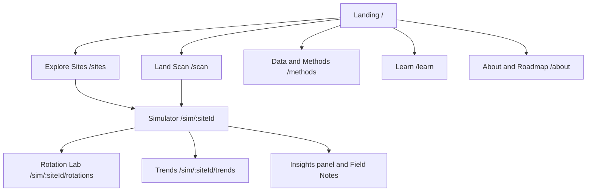
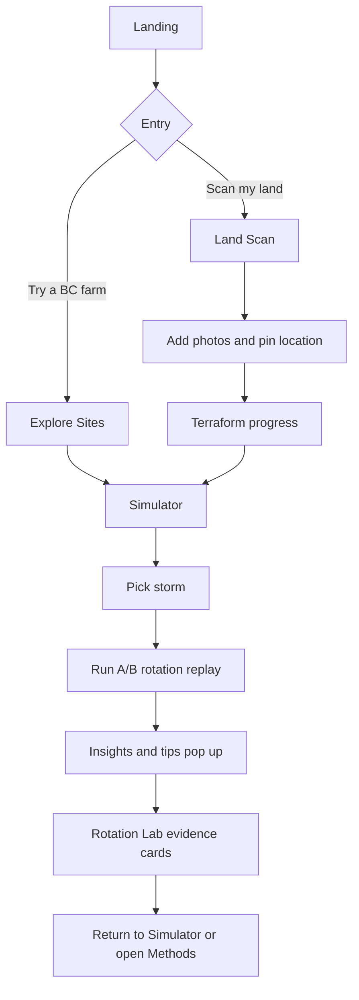
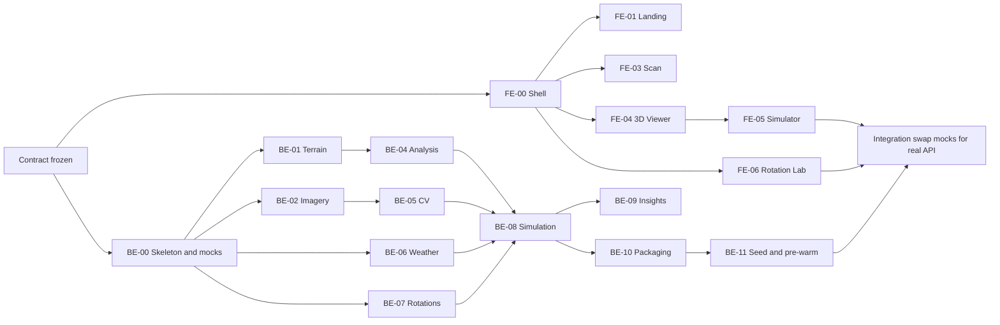

# FieldTwin — Product Requirements Document (v2: Website, Modular Task Plan)

|                  |                                                                                                                                                  |
| ---------------- | ------------------------------------------------------------------------------------------------------------------------------------------------ |
| **Document**     | Product Requirements Document                                                                                                                    |
| **Status**       | Draft v2.0 (supersedes v1, the drone-based single-app PRD)                                                                                       |
| **Created**      | 2026-11-11                                                                                                                                       |
| **Project name** | FieldTwin (working name, provisional)                                                                                                            |
| **Hackathon**    | NASA Space Apps Challenge 2026, Vancouver local event (in person)                                                                                |
| **Challenge**    | Field Shift: Adapting Farms with NASA Data                                                                                                       |
| **Timeframe**    | 48 hours: Sat Nov 14 – Sun Nov 15, 2026. Submission closes Sun 11:59 PM local time ([2026 event page](https://www.spaceappschallenge.org/2026/)) |
| **Product form** | A multi-page website with an interactive 3D land sim`ulator                                                                                      |
| **Constraints**  | Software only, no drone or hardware, live pitch expected, short video demo likely                                                                |

**One-line pitch:** Give FieldTwin a photo and a location of a farm, and it terraforms the land into an interactive 3D model, then replays real historical storms on it so farmers can see where water pools and soil erodes under different crop rotations.

---

## 0. How to use this document

This PRD is built so that several people can work **at the same time without waiting on each other**.

- **Section 6 (Interface contract)** defines the data shapes, API endpoints, and file formats. Read it first. Front-end and back-end both build against it.
- **Part A (Front-end tasks, FE-xx)** covers the website: UI, UX, pages, and the 3D viewer.
- **Part B (Back-end tasks, BE-xx)** covers systems: data pipelines, simulation, APIs, caching.
- Every task is a **self-contained card** with purpose, inputs, outputs, mock data, acceptance criteria, and dependencies. Anyone can pick one up and finish it using the contract and the mocks.
- Front-end tasks never block on back-end tasks, because each has **mock fixtures** (Section 6.8). Back-end tasks never block on front-end tasks, because each is testable through the API alone.
- Priorities: **P0** must-have, **P1** should-have, **P2** stretch. Effort estimates are rough single-person hours and are assumptions, not measurements.

Placeholders like `Owner: ______` are for assigning tasks. Nothing in this document assumes a team size.

---

## 1. Executive overview

### Project at a glance

FieldTwin is a website where a farmer, advisor, or judge picks a piece of farmland, sees it rebuilt as an explorable 3D landscape, and runs a **storm simulator** on it. The simulator replays the heaviest storms from NASA's historical weather record at that location and shows where water runs, where it pools, and where soil is at risk, comparing at least three crop rotations including the existing one. Pop-up insights and plain-language tips explain what the farmer is looking at and what to ask a local expert.

### The problem

Rotation decisions are usually made from rules of thumb and generic suitability lists that ignore the shape of the specific field. Two fields with the same crop and soil behave differently if one has a low corner that floods and a slope that erodes. The challenge asks for a decision-support tool that uses NASA Earth observations along with local information to help farmers explore rotation strategies that may improve soil health and resilience (challenge text supplied by the team; the official page blocks automated access).

### The solution

1. **Land Scan:** The user sends one or more photos of a farm and places it on a map. FieldTwin fetches real elevation (open, LiDAR-derived Canadian data where available, NASA elevation data otherwise), drapes imagery over it, and "terraforms" a 3D model.
2. **Simulator:** Real historical storms from NASA POWER weather data are replayed on that terrain under different rotations, side by side.
3. **Rotation Lab and insights:** Evidence cards, cover calendars, and farmer-facing tips explain why a rotation was suggested, the supporting evidence, benefits, information gaps, and risks needing local review.

### Core features

1. Land Scan: photos + location → 3D terrain with a terraform animation.
2. 3D Land Viewer: orbit, fly-through, and ground-level views with layers (imagery, slope, drainage, ground cover).
3. Storm Simulator: animated runoff and ponding, a relative erosion-risk index, and A/B rotation comparison.
4. Rotation Lab: at least three rotations with calendars and evidence cards.
5. Insight pop-ups and farmer tips anchored to places on the land, plus shareable field notes (P2).

### What makes it interesting

Most farm tools are dashboards or crop recommenders. FieldTwin puts the user _on the land_: the same real storm hits the same real terrain twice under two rotations and the water behaves differently. The first 15 seconds show a photo turning into a landscape; the next 15 show weather history playing out on it. Results are relative and explained, never black-box.

### Hackathon MVP

A deployed or locally runnable website with: landing page; site gallery; Land Scan flow; 3D viewer; storm simulator with A/B rotation replay; Rotation Lab with evidence cards; insights and tips; Data & Methods page. **Guaranteed cases:** three curated BC sites (Section 2.4), each with pre-built terrain, three storms, and three rotations, fully working. **Not guaranteed in the MVP:** arbitrary-location scans, drone uploads, video capture (shown as labeled Roadmap items).

### Demo hook

A user drops photos of a recognizable BC farm into the page, a map pin locks the location, and the land rises into 3D. A historical storm plays in split screen: the left rotation floods a low corner; the right barely does.

### What changed from v1

| v1 (drone-based app)                          | v2 (website)                                                                             | Reason                                           |
| --------------------------------------------- | ---------------------------------------------------------------------------------------- | ------------------------------------------------ |
| Drone imagery and photogrammetry as the input | Photos + location, with elevation from open data and NASA                                | No drone; terrain data already exists publicly   |
| Single application                            | Multi-page website with a dashboard                                                      | New requirement                                  |
| One workstream                                | Compartmentalized FE and BE task cards with contracts and mocks                          | Parallel, asynchronous work                      |
| Drone as core                                 | Drone, video, and other capture methods become future **Capture Adapters** (Section 2.6) | Preserves the idea without depending on hardware |

---

## 2. Product overview and scope

### 2.1 Vision

Make every field's own geometry and weather history part of rotation decisions, with explanations a farmer can interrogate.

### 2.2 Goals

- **G1:** A polished, believable end-to-end journey: photo → 3D land → storm replay → rotation comparison → insights.
- **G2:** A visually striking 3D experience that runs on a laptop in a browser.
- **G3:** NASA data used meaningfully (NASA POWER for weather and soil wetness; NASA elevation data as a source and fallback; NASA imagery services as context).
- **G4:** Every simulation output labeled as modeled and relative, with assumptions one click away.
- **G5:** A reliable demo for specific curated cases, with honest labeling of what is pre-built.

### 2.3 Non-goals

- Real-time drone control, flight planning, or hardware integration.
- Absolute yield (tonnage), profit, or financial predictions.
- A calibrated hydraulic or erosion model.
- User accounts, billing, or multi-tenant features.
- A chatbot or LLM-driven recommender (an optional text-polish step is P2 and must be disclosed).
- Native mobile apps.

### 2.4 Honesty rules (apply to every page and the submission text)

1. **Demo Mode:** Results for curated sites are real pipeline outputs, pre-computed and cached ahead of time. The UI shows a "Pre-built site" badge on them.
2. **Live Scan** for a new location works only where open elevation data exists and the pipeline succeeds; otherwise the UI explains why.
3. Features that do not exist yet (drone upload, video capture) appear only as **Roadmap** items and are never shown working.
4. All simulation outputs are **relative comparisons**, not predictions of real-world outcomes.
5. The project page lists every dataset used, with licenses and attributions.

**Curated demo sites (to be chosen and verified before the event).** Pick three sites that are recognizable to a BC audience, have visible relief, have open LiDAR elevation coverage, and have license-clear imagery. Candidates to evaluate, none verified:

- Sumas Prairie area, Abbotsford (strong local story; the 2021 floods were largely river and lake overflow, which this tool does not model, so frame it as local runoff and ponding only).
- Okanagan vineyard or orchard slopes (visible relief and erosion potential).
- UBC Farm, Vancouver (local and recognizable; small).
  Final site choice is an **open question** (Section 12).

### 2.5 Users and use cases

| User                                    | Context and need                                              | Goal                                                      |
| --------------------------------------- | ------------------------------------------------------------- | --------------------------------------------------------- |
| **Farm advisor / agronomist** (primary) | Advises several growers; needs visual, defensible comparisons | Compare rotations on a specific field                     |
| **Farmer / operator**                   | Knows the land; wants to see what changes                     | Understand problem areas and trade-offs in plain language |
| **Judge / visitor**                     | Has 30 seconds to understand                                  | Grasp the idea from the landing page and demo             |

Key use cases: **UC-1** scan a farm into 3D; **UC-2** explore terrain and drainage; **UC-3** replay a historical storm; **UC-4** compare three rotations; **UC-5** read insights and tips; **UC-6** review weather trends.

### 2.6 Capture Adapters: the drone idea, preserved

The drone remains the ideal input because it can map a whole field at centimeter detail. Because there is no drone for the hackathon, the system is designed around a **Capture Adapter** interface: any adapter that can produce a standard `TerrainPackage` (Section 6.2) plugs into the same simulator.

| Adapter                                      | How terrain and texture are obtained                                                       | Status        |
| -------------------------------------------- | ------------------------------------------------------------------------------------------ | ------------- |
| **A1. Photos + location** (default)          | User photos are the visual texture; elevation comes from open DEMs for the pinned location | P0            |
| **A2. Open data only**                       | Elevation from open DEMs; imagery from NASA services or other open sources                 | P0 (fallback) |
| **A3. Drone map upload**                     | User uploads orthophoto + elevation GeoTIFFs (for example from OpenDroneMap)               | P2 / Roadmap  |
| **A4. Raw drone photos or video**            | Photogrammetry or learned reconstruction (minutes to hours of processing)                  | Roadmap only  |
| **A5. Estimated relief from a single photo** | A monocular depth model estimates _relative_ relief; clearly labeled experimental          | P2            |

Why A1 instead of "photos alone": a single aerial photo does not contain trustworthy elevation. Pairing photos with a location lets the system use measured terrain from real datasets and keep the photo as the visual layer. This is the honest way to get an accurate-looking 3D result without a drone.

### 2.7 Scope hierarchy

- **P0:** Needed for the demo path and the challenge deliverables (Sections 7 and 8 mark each task).
- **P1:** Improves completeness and judging quality; cut if behind.
- **P2:** Stretch, only after everything else is stable.

**Minimum viable demo path** (everything else can be cut first): FE-00, FE-01 (light), FE-03, FE-04, FE-05, FE-06 (light), FE-12; BE-00, BE-01, BE-02, BE-03, BE-04, BE-06, BE-07, BE-08, BE-10, BE-11.

---

## 3. Competition fit

**Status: provisional.** The 2026 Judging & Awards Guide releases November 13 ([participant FAQs](https://www.spaceappschallenge.org/resources/participant-faqs/)). The mapping below uses the criteria published for 2024–2025 ([2024 guide](https://spaceappschallenge.org/resources/judging-awards-guide), [2025 submission guide](https://www.spaceappschallenge.org/resources/project-submission-guide)): Impact (called Influence in 2024), Creativity, Validity, Relevance, Presentation. No weights have been published, and none are assumed. Re-verify on Nov 13.

| Criterion        | What judges evaluate                          | Product response                                                                                                   | Where it shows                  |
| ---------------- | --------------------------------------------- | ------------------------------------------------------------------------------------------------------------------ | ------------------------------- |
| **Impact**       | Size and quality of benefit                   | Field-specific, visual rotation comparison for any area with open elevation data; BC examples                      | Compare page; Roadmap page      |
| **Creativity**   | Novel vs incremental                          | Photo-to-3D terraforming plus storm replay under rotation-specific cover                                           | Land Scan; A/B replay           |
| **Validity**     | Scientifically sound and workable             | Open LiDAR/NASA elevation, NASA POWER weather, standard hydrology methods, relative metrics, provenance            | Data & Methods page; unit tests |
| **Relevance**    | Responsive to the challenge; complete; usable | Three rotations with why / evidence / benefits / gaps / risks; farmer-centered tips; support-not-replace messaging | Rotation Lab; evidence cards    |
| **Presentation** | Clear storytelling                            | Landing page, guided demo mode, 30-second demo                                                                     | FE-01, FE-12                    |

**Submission logistics (2025 values; confirm for 2026):** the demo was a video up to 30 seconds or a deck of up to seven slides; projects exceeding limits were not eligible for Global Judging; NASA data use is required for Global Awards; AI tool use must be disclosed, and AI-generated imagery or video needs a visible watermark ([2025 submission guide](https://www.spaceappschallenge.org/resources/project-submission-guide)). Follow Space Apps brand guidelines and do not put NASA logos into generated media.

**Challenge deliverables mapped:** "compare at least three rotation strategies including the existing one" is FE-06 + BE-07; "explain why, evidence, benefits, information gaps, risks" is the evidence card (BE-09); "explain scientific terms" is the Learn page (FE-09) and tooltips; "support, not replace, farmer judgment" is a persistent banner and footer text.

---

## 4. Website concept: site map and page ideas

### 4.1 Site map



### 4.2 Page inventory

| Page                      | Route                    | Purpose                                                          | MVP | Task                |
| ------------------------- | ------------------------ | ---------------------------------------------------------------- | --- | ------------------- |
| **Landing**               | `/`                      | Explain the idea in 15 seconds; hero 3D terraform; CTA           | P0  | FE-01               |
| **Explore Sites**         | `/sites`                 | Gallery and BC map of curated farms; entry to the simulator      | P0  | FE-02               |
| **Land Scan**             | `/scan`                  | Send photos, place on map, watch the terraform                   | P0  | FE-03               |
| **Simulator (dashboard)** | `/sim/:siteId`           | 3D map, storm replay, A/B rotations, HUD, insights               | P0  | FE-04, FE-05, FE-07 |
| **Rotation Lab**          | `/sim/:siteId/rotations` | Three rotations, calendars, evidence cards                       | P0  | FE-06               |
| **Trends**                | `/sim/:siteId/trends`    | Long-term weather and soil-wetness trends; climate-shift sliders | P1  | FE-11               |
| **Data & Methods**        | `/methods`               | Datasets, licenses, assumptions, measured vs modeled             | P0  | FE-08               |
| **Learn**                 | `/learn`                 | Plain-language glossary and explainers                           | P1  | FE-09               |
| **About & Roadmap**       | `/about`                 | Story, team, future capture modes (drone, video), contact        | P1  | FE-10               |

### 4.3 Additional page ideas (beyond the MVP)

- **Storm Library:** browsable catalog of historical storms with one-click replay on any site.
- **Rotation Playbook:** library of rotation patterns with explanations, pros, cons, and BC context.
- **Advisor Mode:** printable one-page comparison for a client meeting.
- **Capture Studio (Roadmap):** the future home of drone-map upload and video capture, shown as an explainer with a mock flow.
- **Community:** shared field notes and regional discussion (needs accounts; out of scope now).
- **Open Data Explorer:** lets visitors see the elevation and weather data behind any result.

### 4.4 Primary user journey



---

## 5. Work breakdown at a glance

| ID    | Task                                             | Side | Pri   | Est (h) | Depends on                 |
| ----- | ------------------------------------------------ | ---- | ----- | ------- | -------------------------- |
| FE-00 | Design system and app shell                      | FE   | P0    | 5       | Contract                   |
| FE-01 | Landing page                                     | FE   | P0    | 6       | FE-00                      |
| FE-02 | Explore Sites                                    | FE   | P0    | 4       | FE-00                      |
| FE-03 | Land Scan page                                   | FE   | P0    | 8       | FE-00                      |
| FE-04 | 3D Land Viewer component                         | FE   | P0    | 12      | FE-00                      |
| FE-05 | Simulator dashboard                              | FE   | P0    | 12      | FE-04                      |
| FE-06 | Rotation Lab                                     | FE   | P0    | 8       | FE-00                      |
| FE-07 | Insights, tips, field notes                      | FE   | P0/P2 | 6       | FE-04, FE-05               |
| FE-08 | Data & Methods page                              | FE   | P0    | 3       | FE-00                      |
| FE-09 | Learn page                                       | FE   | P1    | 3       | FE-00                      |
| FE-10 | About, Roadmap, contact                          | FE   | P1    | 3       | FE-00                      |
| FE-11 | Trends view                                      | FE   | P1    | 5       | FE-00                      |
| FE-12 | Guided Demo Mode and Presentation Mode           | FE   | P0    | 5       | FE-01 to FE-06             |
| FE-13 | QA, performance, accessibility pass              | FE   | P0    | 6       | Most FE                    |
| BE-00 | Repo, API skeleton, contracts, mocks             | BE   | P0    | 4       | None                       |
| BE-01 | Terrain source adapters                          | BE   | P0    | 8       | BE-00                      |
| BE-02 | Imagery and image placement                      | BE   | P0    | 6       | BE-00                      |
| BE-03 | Scan orchestration and progress events           | BE   | P0    | 5       | BE-00                      |
| BE-04 | Terrain analysis                                 | BE   | P0    | 6       | BE-01                      |
| BE-05 | Cover classification (computer vision)           | BE   | P0    | 6       | BE-02                      |
| BE-06 | Weather service, storm library, trends           | BE   | P0    | 6       | BE-00                      |
| BE-07 | Crop library and rotation engine                 | BE   | P0    | 5       | BE-00                      |
| BE-08 | Storm simulation engine                          | BE   | P0    | 14      | BE-04, BE-05, BE-06, BE-07 |
| BE-09 | Insight, tips, and evidence generator            | BE   | P0    | 6       | BE-04, BE-08               |
| BE-10 | Rendering packaging (heightmaps, layers, frames) | BE   | P0    | 5       | BE-01, BE-08               |
| BE-11 | Seed data, pre-warm, offline cache               | BE   | P0    | 6       | BE-01 to BE-10             |
| BE-12 | Testing harness and smoke tests                  | BE   | P0    | 5       | BE-00                      |
| BE-14 | Relative yield-stress index                      | BE   | P1    | 5       | BE-06, BE-07               |
| BE-13 | Capture adapters (drone upload, depth estimate)  | BE   | P2    | 10      | BE-01                      |

P0 totals about 157 task-hours; P1 about 16; P2 about 10. These are rough. If capacity is lower, cut in the order in Section 10.3.

**Task dependency view (everything can start after contracts freeze):**



---

## 6. Interface contract (read this first)

This section is the shared agreement between front-end and back-end. **Freeze it by hour 3 of the hackathon.** After that, any change needs a short note to everyone and a version bump (`v1` → `v1.1`). All endpoints, schemas, and formats below are _our own_ design and may be adjusted before the freeze. External data-source endpoints are separate and must be verified (Part B).

### 6.1 Conventions

- **Base URL:** `/api/v1`. JSON unless stated. UTF-8. Timestamps ISO 8601 UTC.
- **IDs:** short strings with a type prefix, for example `terr_…`, `scan_…`, `storm_…`, `rot_…`, `sim_…`.
- **Coordinates:** public API uses WGS84 `[lon, lat]` and bounding boxes `[minLon, minLat, maxLon, maxLat]`. Internal grids use a local projected CRS (UTM), declared in metadata.
- **Units:** meters, millimeters, degrees, percent. Every response value that is modeled carries `"basis": "measured" | "derived" | "modeled" | "assumed"` where relevant.
- **Errors:** one format everywhere (Section 6.6).
- **Caching:** content is immutable per ID; send `Cache-Control: public, max-age=31536000, immutable` for asset files.
- **Mock mode:** the front-end reads `NEXT_PUBLIC_API_MODE=mock|live` (Section 6.8).

### 6.2 Core data schemas

### TerrainPackage (the single object every capture adapter must produce)

```json
{
  "id": "terr_demo_okanagan_01",
  "name": "Example Okanagan hillside",
  "site_id": "site_okanagan_01",
  "bbox_wgs84": [-119.6, 49.1, -119.58, 49.12],
  "crs": "EPSG:32611",
  "grid": {
    "width": 512,
    "height": 512,
    "cell_size_m": 2.0,
    "nodata_fraction": 0.0
  },
  "elevation": {
    "min_m": 280.4,
    "max_m": 352.9,
    "model": "DTM",
    "vertical_datum": "to_verify"
  },
  "assets": {
    "heightmap": "/api/v1/terrain/terr_demo_okanagan_01/heightmap.png",
    "normal_map": "/api/v1/terrain/terr_demo_okanagan_01/normal.png",
    "texture": "/api/v1/terrain/terr_demo_okanagan_01/texture.jpg",
    "layers": {
      "slope": "/api/v1/terrain/terr_demo_okanagan_01/layers/slope.png",
      "flow_accumulation": "/api/v1/terrain/terr_demo_okanagan_01/layers/flow_accumulation.png",
      "depressions": "/api/v1/terrain/terr_demo_okanagan_01/layers/depressions.png",
      "cover_class": "/api/v1/terrain/terr_demo_okanagan_01/layers/cover_class.png"
    }
  },
  "texture": {
    "bounds_wgs84": [-119.6, 49.1, -119.58, 49.12],
    "source": "user_upload | open_imagery | nasa_gibs",
    "resolution_m": 0.5,
    "license": "string",
    "attribution": "string"
  },
  "sources": [
    {
      "name": "string",
      "role": "elevation | imagery | weather",
      "resolution_m": 2.0,
      "license": "string",
      "url": "string",
      "basis": "measured"
    }
  ],
  "quality_flags": [
    "coarse_elevation",
    "dsm_includes_vegetation",
    "texture_alignment_assumed"
  ],
  "created_at": "2026-11-14T18:00:00Z"
}
```

- **Heightmap decoding:** 16-bit grayscale PNG; `elevation_m = min_m + (value / 65535) * (max_m - min_m)`.
- **Layer PNGs:** 8-bit grayscale unless noted. `cover_class` uses indexed values: `0 other`, `1 vegetation`, `2 bare soil`, `3 water`, `255 nodata`.
- **Layer legends** are described in `GET /terrain/{id}/layers` (name, unit, value range, color ramp hint).

### Site

```json
{
  "id": "site_okanagan_01",
  "name": "string",
  "region": "Okanagan | Fraser Valley | Metro Vancouver | other",
  "summary": "string",
  "relief_m": 72.5,
  "area_ha": 40.0,
  "terrain_id": "terr_demo_okanagan_01",
  "preview_image": "/assets/sites/okanagan_01.jpg",
  "pre_built": true,
  "storm_ids": ["storm_a", "storm_b", "storm_c"],
  "attribution": ["string"]
}
```

### Storm

```json
{
  "id": "storm_example_1",
  "label": "Wettest 3-day event on record (example)",
  "start": "YYYY-MM-DD",
  "end": "YYYY-MM-DD",
  "total_mm": 0.0,
  "peak_day_mm": 0.0,
  "antecedent_wetness": 0.0,
  "hyetograph": {
    "step_minutes": 60,
    "mm": [0.0],
    "synthetic": true,
    "profile": "design_storm_assumed"
  },
  "weather_source": {
    "name": "NASA POWER",
    "resolution_km": 55,
    "basis": "measured"
  }
}
```

All numbers above are placeholders. Real values come from BE-06.

### CropTemplate and Rotation

```json
{
  "crop": {
    "id": "crop_rye_cover",
    "name": "Cereal rye (cover crop)",
    "family": "Poaceae",
    "n_fixing": false,
    "season_window": { "plant_doy": 260, "terminate_doy": 120 },
    "cover_curve": [
      [0, 0.1],
      [60, 0.5],
      [120, 0.9]
    ],
    "notes": "string",
    "source": "to_verify"
  },
  "rotation": {
    "id": "rot_existing",
    "name": "Silage corn / winter wheat",
    "is_existing": true,
    "sequence": [
      { "year": 1, "crop_id": "crop_corn_silage" },
      { "year": 2, "crop_id": "crop_wheat_winter" }
    ],
    "cover_calendar": {
      "days_bare_per_year": [210, 150],
      "monthly_cover": [[0.1, 0.1, 0.2]]
    }
  }
}
```

### SimulationRequest / SimulationStatus

```json
{
  "terrain_id": "terr_demo_okanagan_01",
  "storm_id": "storm_example_1",
  "rotation_ids": ["rot_existing", "rot_cover", "rot_forage"],
  "options": {
    "grid_max": 256,
    "frames": 60,
    "soil_group": "B",
    "soil_group_basis": "assumed"
  }
}
```

```json
{
  "id": "sim_123",
  "status": "queued | running | done | failed",
  "progress": 0.0,
  "cached": false,
  "results": {
    "rot_existing": {
      "frames": "/api/v1/simulations/sim_123/frames/rot_existing.bin",
      "risk": "/api/v1/simulations/sim_123/risk/rot_existing.png",
      "metrics": {}
    }
  }
}
```

### Metrics (per rotation, per storm)

```json
{
  "runoff_volume_m3": 0.0,
  "runoff_depth_mm_mean": 0.0,
  "ponded_area_ha": 0.0,
  "ponded_peak_depth_cm": 0.0,
  "erosion_index_mean": 0.0,
  "erosion_high_share_pct": 0.0,
  "bare_days_per_year": 0.0,
  "basis": {
    "runoff": "modeled",
    "ponding": "modeled",
    "erosion_index": "relative"
  }
}
```

### Insight and EvidenceCard

```json
{
  "id": "ins_001",
  "kind": "terrain | cover | storm | rotation | data_quality",
  "title": "string",
  "body": "string",
  "why_it_matters": "string",
  "tip": "string",
  "confidence": "low | medium | high",
  "anchor": { "lon": 0.0, "lat": 0.0, "at_time_min": null },
  "data_refs": ["layers.slope"],
  "severity": 1
}
```

```json
{
  "rotation_id": "rot_cover",
  "why_suggested": "string",
  "evidence": ["string"],
  "benefits": ["string"],
  "information_gaps": ["string"],
  "risks_for_local_review": ["string"],
  "support_not_replace": "This tool supports, and does not replace, local agronomic expertise."
}
```

### 6.3 Endpoints

| Method | Path                                           | Purpose                                                                          | Returns                                     |
| ------ | ---------------------------------------------- | -------------------------------------------------------------------------------- | ------------------------------------------- |
| GET    | `/health`                                      | Liveness and mode (`offline`, `live`)                                            | `{status, mode, version}`                   |
| GET    | `/sites`                                       | List curated sites                                                               | `Site[]`                                    |
| GET    | `/sites/{siteId}`                              | One site                                                                         | `Site`                                      |
| POST   | `/scans`                                       | Start a Land Scan (multipart: `images[]`, `lat`, `lon`, optional `bbox`, `name`) | `{scan_id}`                                 |
| GET    | `/scans/{scanId}`                              | Scan status and result                                                           | `{status, stage, pct, terrain_id?, error?}` |
| GET    | `/scans/{scanId}/events`                       | Server-sent progress events                                                      | SSE stream (Section 6.5)                    |
| GET    | `/terrain/{terrainId}`                         | TerrainPackage metadata                                                          | `TerrainPackage`                            |
| GET    | `/terrain/{terrainId}/heightmap.png`           | 16-bit heightmap                                                                 | PNG                                         |
| GET    | `/terrain/{terrainId}/normal.png`              | Normal map                                                                       | PNG                                         |
| GET    | `/terrain/{terrainId}/texture.jpg`             | Draped imagery                                                                   | JPEG                                        |
| GET    | `/terrain/{terrainId}/layers`                  | Layer catalog with legends                                                       | JSON                                        |
| GET    | `/terrain/{terrainId}/layers/{name}.png`       | A single analysis layer                                                          | PNG                                         |
| GET    | `/terrain/{terrainId}/insights`                | Terrain and cover insights                                                       | `Insight[]`                                 |
| GET    | `/terrain/{terrainId}/provenance`              | Data sources, assumptions, limits                                                | JSON                                        |
| GET    | `/weather/summary?lat&lon`                     | Trend summary 1981–present                                                       | JSON                                        |
| GET    | `/weather/storms?terrain_id`                   | Ranked storm list                                                                | `Storm[]`                                   |
| GET    | `/crops`                                       | Crop library                                                                     | `CropTemplate[]`                            |
| GET    | `/rotations/presets?terrain_id`                | Existing plus two suggested rotations                                            | `Rotation[]`                                |
| POST   | `/rotations/validate`                          | Validate a user-edited rotation                                                  | `{valid, warnings[]}`                       |
| POST   | `/simulations`                                 | Run or fetch cached simulation                                                   | `SimulationStatus`                          |
| GET    | `/simulations/{simId}`                         | Status and result links                                                          | `SimulationStatus`                          |
| GET    | `/simulations/{simId}/frames/{rotationId}.bin` | Water-depth frames                                                               | Binary (Section 6.4)                        |
| GET    | `/simulations/{simId}/risk/{rotationId}.png`   | Relative erosion-risk grid                                                       | PNG                                         |
| GET    | `/simulations/{simId}/evidence`                | Evidence cards and insights for the run                                          | `EvidenceCard[]` + `Insight[]`              |
| GET    | `/simulations/{simId}/diff?a&b`                | Difference grid between two rotations                                            | PNG + stats                                 |
| POST   | `/notes` and GET `/notes?terrain_id`           | Field notes (P2; may be local-only in the front-end)                             | `Note`                                      |

### 6.4 Frame file format (water-depth animation)

Binary, little-endian, one file per rotation per simulation.

```
bytes 0-3    magic "FTW1"
bytes 4-5    u16 width
bytes 6-7    u16 height
bytes 8-9    u16 frame_count
byte  10     u8  dtype (1 = uint8)
byte  11     u8  reserved
bytes 12-15  f32 max_depth_mm (value 255 maps to this depth)
bytes 16-... frame_count * width * height bytes, frames in time order
```

`depth_mm = byte * max_depth_mm / 255`. A companion JSON in the status response lists `step_minutes` and `frame_times`. Target size per file: under about 5 MB (for example, 60 frames at 256×256 is about 4 MB before compression); serve with gzip.

### 6.5 Progress events (Server-Sent Events)

```
event: progress
data: {"scan_id":"scan_abc","stage":"building_mesh","pct":45,"message":"Building terrain mesh","ts":"…"}
```

Stage enum (in order): `queued`, `reading_inputs`, `locating`, `fetching_elevation`, `building_mesh`, `classifying_cover`, `analyzing_drainage`, `fetching_weather`, `packaging`, `ready`, `failed`. The front-end maps these to the terraform animation steps in FE-03. A final `ready` event includes `terrain_id`.

### 6.6 Error format

```json
{
  "error": {
    "code": "TERRAIN_COVERAGE_MISSING",
    "message": "No open elevation data found for this location.",
    "hint": "Try a site in southern BC or use a curated site.",
    "retryable": false
  }
}
```

Codes (extend as needed): `INVALID_INPUT`, `UNSUPPORTED_FILE`, `FILE_TOO_LARGE`, `TERRAIN_COVERAGE_MISSING`, `DATA_SOURCE_UNAVAILABLE`, `WEATHER_UNAVAILABLE`, `SIMULATION_TIMEOUT`, `NOT_FOUND`, `INTERNAL`.

### 6.7 Shared rules

1. **Relative vs modeled labels** are mandatory in every UI that shows simulation numbers.
2. **Provenance:** every package lists its sources, licenses, and quality flags; the UI must be able to show them.
3. **Determinism:** the same inputs produce the same outputs, so caching and tests are reliable.
4. **Offline-capable demo:** with `OFFLINE=1`, the API serves only pre-built seed data and never calls external services.

### 6.8 Mock fixtures (so nobody waits)

BE-00 delivers a `packages/contracts/fixtures/` folder with: sample JSON for every schema; a procedurally generated demo terrain (heightmap, normal map, texture, layers); a fake 60-frame water animation file in the real binary format; sample SSE event streams; storm and rotation lists; and evidence cards. The front-end switches to these with `NEXT_PUBLIC_API_MODE=mock`; a tiny mock server (or static files under `/public/mock`) serves the same paths as the real API. Fake data must be visibly labeled "mock" in development builds so it never reaches the demo by accident.

---

## 7. PART A: FRONT-END, UI AND UX TASKS

**Recommended stack (change if the repository already has conventions):** Next.js (App Router) + TypeScript, Tailwind CSS, react-three-fiber (three.js) for 3D, MapLibre GL JS for the 2D location map, Framer Motion for UI motion, Zustand for state, a charting library (Recharts or visx), and `openapi-typescript` to generate types from the contract. No repository was inspected when this PRD was written.

**Rules for every FE task:** build against the contract and mock fixtures first; handle loading, empty, error, and success states; show "mock" and "pre-built" badges where relevant; keep text at a plain-language reading level for farmers; never show a simulation number without its basis label.

---

### 7.0 Shared design direction (owned by FE-00, used by all FE tasks)

- **Mood:** calm, grounded, scientific, with cinematic moments. The land is always the hero; interface chrome stays quiet.
- **Palette (tokens, not hard-coded hex):** dark neutral surfaces for the dashboard; warm light surfaces for content pages; earth tones for land and cover; one cool hue family for water; amber to red for risk; a single accent for primary actions. Risk and status are encoded with color **plus** icon or pattern.
- **Typography:** one expressive display face for headings, one clean sans for UI text, a monospaced face for numbers and units. Large, legible sizes for projector use.
- **Components:** consistent cards, chips, sliders, tabs, tooltips, pop-overs, toasts, skeleton loaders, and a standard "Basis" chip (`measured`, `derived`, `modeled`, `assumed`).
- **Motion:** purposeful only. Terraform rise, time-scrub water, cross-fades between rotations, and pop-up entrances. Respect `prefers-reduced-motion`.
- **Voice:** direct and practical. Use "may", "consider", and "ask a local agronomist" rather than absolute claims.

---

### FE-00: Design system and app shell

**Priority:** P0 · **Est.:** 5 h · **Owner:** **\_\_** · **Depends on:** contract · **Unblocks:** all FE tasks

- **Purpose:** Give every page a consistent frame so tasks can be built in parallel without style drift.
- **Deliverables:** project scaffold; routing for all routes in Section 4.2; global layout with top navigation (Home, Sites, Scan, Simulator, Methods, Learn, About); footer with data attributions and the support-not-replace statement; design tokens; base components (Button, Card, Chip, Tabs, Slider, Tooltip, Popover, Modal, Toast, Skeleton, BasisChip, ProvenanceButton); API client with mock/live switch and generated types; global state store skeleton; error boundary and 404.
- **Interactions and states:** keyboard-focus styles; responsive layout for 1280–1920 px desktop (mobile is out of scope but must not break); dark and light surfaces per page type.
- **Mock data:** `/mock` fixtures from BE-00; if BE-00 is late, hand-write three JSON files.
- **Acceptance criteria:**
  - [ ] All routes render placeholder pages with the shared shell.
  - [ ] Components render in a simple style-guide page (`/dev/styleguide`).
  - [ ] API client switches between mock and live via an environment variable.
  - [ ] Footer shows data attributions and the support-not-replace line on every page.

---

### FE-01: Landing page

**Priority:** P0 · **Est.:** 6 h · **Owner:** **\_\_** · **Depends on:** FE-00

- **Purpose:** Let a judge or visitor understand the product in 15 seconds and want to try it.
- **Route:** `/`.
- **Layout (top to bottom):**
  1. **Hero:** headline, one-sentence subhead, two buttons ("Explore a BC farm", "Scan your land"). Background is a looping 3D (or pre-rendered video) terraform: flat plane rises into terrain, imagery fades in, water flows. Use real terrain from a curated site.
  2. **How it works:** three steps with small animations: Send a photo and place it → See it in 3D → Replay a storm.
  3. **See the storm:** an embedded mini A/B comparison using real pre-computed frames from one curated site (labeled "Pre-built example").
  4. **What you get:** four feature tiles (3D land, storm replay, rotation comparison, plain-language tips).
  5. **Built on open data:** a text-only credibility strip listing NASA POWER, NASA elevation data, Natural Resources Canada elevation data (no logos; follow brand guidelines).
  6. **Roadmap teaser:** "Drone and video capture coming" with a link to About.
  7. **Final call to action** and footer.
- **Copy draft (adjust freely):** Headline "See how your land handles the next storm." Subhead "Send a photo of a field. FieldTwin rebuilds it in 3D and replays real weather history on it." Avoid claims of accuracy or yield.
- **Interactions:** scroll-triggered reveals; buttons deep-link to `/sites` and `/scan`; the mini comparison has play/pause and a swipe handle.
- **Data/API:** `GET /sites`, one frames file for the teaser (or a video fallback).
- **States:** if WebGL is unavailable, use a still image and a pre-rendered video.
- **Acceptance criteria:**
  - [ ] A first-time visitor can state what the product does after 15 seconds (test with a teammate).
  - [ ] Both CTAs work; the teaser plays real or clearly labeled pre-rendered frames.
  - [ ] Largest content paints in a reasonable time on the demo laptop (target under about 3 s, to be measured).
  - [ ] No claims of accuracy or yield prediction appear.

---

### FE-02: Explore Sites

**Priority:** P0 · **Est.:** 4 h · **Owner:** **\_\_** · **Depends on:** FE-00

- **Purpose:** Fast, reliable entry to the curated demo sites.
- **Route:** `/sites`.
- **Layout:** left: card grid; right: MapLibre map of BC with pins (hover a card highlights its pin). Filters by region (Okanagan, Fraser Valley, Metro Vancouver) and terrain type (flat, rolling, steep) derived from `relief_m`.
- **Card contents:** preview image, name, region, area, relief, "Pre-built" badge, number of storms available, primary button "Open in simulator".
- **Interactions:** card click opens `/sim/:siteId`; a secondary "Scan a new location" card links to `/scan`.
- **Data/API:** `GET /sites`.
- **States:** loading skeletons; empty state ("No sites available") with a link to Scan; error card with retry.
- **Acceptance criteria:**
  - [ ] All curated sites appear with correct stats and attributions.
  - [ ] Map and cards stay in sync.
  - [ ] Keyboard users can open a site.

---

### FE-03: Land Scan page (input and terraform)

**Priority:** P0 · **Est.:** 8 h · **Owner:** **\_\_** · **Depends on:** FE-00 · **Back-end counterpart:** BE-03 (works against mocks without it)

- **Purpose:** The "send us a photo" moment and the terraform animation that follows.
- **Route:** `/scan`. A three-step wizard with a visible progress indicator.
- **Capture source tabs (top of page):** **Photos + location** (active), **Drone map (GeoTIFF)**, **Drone video**. The drone tabs are visible but disabled with a "Roadmap" label and a short explainer, so the drone idea is represented honestly.
- **Step 1, Add photos:** large drop zone accepting 1–6 images (JPG, PNG, WEBP; size cap shown). Thumbnails with remove buttons. A "Use a sample farm" row of the curated sites, each with sample images, one click to fill the wizard. If an image has location metadata, offer to use it.
- **Step 2, Place it on the map:** MapLibre map with a search-by-coordinates field and click-to-pin. A resizable rectangle sets the area (side length limits shown, for example 0.25–5 km). The user's photo shown as a reference thumbnail beside the map. Warning chip if the location is outside supported data coverage once known.
- **Step 3, Terraform:** a full-screen sequence driven by progress events from the back-end. Stages and visual treatment:
  1. _Reading your photos_ (thumbnails scan).
  2. _Locating the land_ (map zooms to the rectangle).
  3. _Fetching elevation_ (contour lines draw).
  4. _Building the terrain_ (flat plane **rises** into 3D using the real heightmap).
  5. _Reading the ground cover_ (cover colors sweep across).
  6. _Tracing the drainage_ (flow lines draw).
  7. _Ready_ (camera flies into the simulator).
     The animation must reflect real progress; if a stage finishes quickly, it plays a short minimum duration but never fakes a stage that did not run.
- **Data/API:** `POST /scans`, `GET /scans/{id}/events` (SSE), `GET /terrain/{id}`, heightmap and texture assets.
- **Error handling:** `TERRAIN_COVERAGE_MISSING` shows the message and hint, plus buttons "Try a curated site" and "Change location"; `FILE_TOO_LARGE` and `UNSUPPORTED_FILE` appear inline at the drop zone.
- **Mock data:** SSE fixture streams; fixture terrain.
- **Acceptance criteria:**
  - [ ] A user can add images, pin a location, and see the terraform sequence end with a working simulator.
  - [ ] Sample-farm shortcut completes the wizard in two clicks.
  - [ ] Disabled drone tabs clearly say "Roadmap".
  - [ ] Every back-end stage maps to a visible step; failures stop at the failing step with a recovery path.
  - [ ] Works with the mock and with the live API.

---

### FE-04: 3D Land Viewer component

**Priority:** P0 · **Est.:** 12 h · **Owner:** **\_\_** · **Depends on:** FE-00 · **Used by:** FE-03, FE-05, FE-07

- **Purpose:** The reusable, high-quality 3D view of the land. This is the core of the product's look and feel.
- **Props (suggested):** `terrainId`, `layers`, `verticalExaggeration`, `waterFrames` (typed array + header), `frameIndex`, `riskGrid`, `cameraState`, `onPick(point)`, `splitMode`.
- **Rendering requirements:**
  - Terrain mesh displaced from the 16-bit heightmap with a lit normal map; imagery draped as texture; sky, soft lighting, and distance fog; scale bar and north indicator.
  - **Layers (toggles):** imagery, slope, drainage lines (flow accumulation), low spots (depressions), ground cover classes, erosion-risk overlay.
  - **Water overlay:** per-frame depth texture rendered as translucent water, color intensity by depth, with an optional animated flow-line effect (P1).
  - **Camera modes:** _Orbit_ (default); _Fly-through_ (guided path that sweeps the land); _Ground view_ (P1: low camera that "walks" the terrain so the user feels they are standing there); smooth transitions between modes; "reset view".
  - **Realism boosters (P1):** instanced low-poly crop rows or trees from the cover map; time-of-day slider for light angle.
  - **Picking:** click or hover returns elevation, slope, ground cover, and (when a simulation is loaded) water depth and risk, shown in a small readout.
- **Performance:** terrain grid up to about 512×512; target at least 30 fps in A/B mode and 60 fps in single mode on a modern laptop (to be measured); automatic quality reduction if frame time is high.
- **Fallback:** if WebGL is unavailable, show a 2D map view with the same layers and the water frames drawn on a canvas.
- **Data/API:** terrain assets and layers; simulation frames (decoded per Section 6.4).
- **Mock data:** procedural terrain and fake frames.
- **Acceptance criteria:**
  - [ ] Heightmap decoding matches the contract; relative elevations look correct (verify with the tilted-plane fixture).
  - [ ] All listed layers toggle without reloading assets.
  - [ ] Water frames scrub smoothly with the frame index prop.
  - [ ] Picking readouts show correct values on the fixture.
  - [ ] Dropping to 2D fallback works when WebGL is disabled.

---

### FE-05: Simulator dashboard

**Priority:** P0 · **Est.:** 12 h · **Owner:** **\_\_** · **Depends on:** FE-04 · **Back-end counterpart:** BE-08 (mocks available)

- **Purpose:** The product's main screen: choose a storm, run it, and watch.
- **Route:** `/sim/:siteId`.
- **Layout:** left rail (controls), center (3D viewer), right panel (insights), bottom bar (timeline).
  - **Left rail:** site name and badges ("Pre-built"), **Storm picker** (cards with date range, total rainfall, antecedent wetness, a "synthetic timing" tag), **Rotation chips** (three, existing marked), layer toggles, vertical exaggeration slider, "Run replay" button.
  - **Center:** the 3D viewer. **A/B mode** splits into two synchronized views, each with a rotation selector; a **Difference** toggle shows where outcomes differ, with a legend.
  - **HUD (overlay in the viewer):** live metrics for the current frame (water volume moving, ponded area, peak depth), always with units and a "modeled" chip.
  - **Bottom timeline:** hyetograph (rain over time) with a scrubber, play/pause, speed control (0.5× to 4×), and event markers where insights fire.
  - **Right panel:** tabs _Insights_, _Metrics_, _Layers_ (see FE-07 for insight content).
- **Interactions:** keyboard shortcuts (Space play/pause, arrow keys step, `A/B` swap, `D` difference); selecting a new storm or rotation requests `POST /simulations` and shows per-rotation progress; cached results appear instantly with a "cached" chip.
- **Data/API:** `GET /weather/storms`, `GET /rotations/presets`, `POST /simulations`, frames, risk grids, `GET /simulations/{id}/evidence`.
- **States:** loading and progress per rotation; error with retry; timeout message with an option to lower grid resolution; offline indicator.
- **Acceptance criteria:**
  - [ ] A user can select a storm, run it for three rotations, and play it in A/B mode.
  - [ ] Both views stay in sync (camera and time).
  - [ ] Switching a side's rotation updates within about a second when cached.
  - [ ] HUD numbers change with the frame and always show units plus the modeled chip.
  - [ ] Difference overlay has a legend and works for any pair of rotations.

---

### FE-06: Rotation Lab

**Priority:** P0 · **Est.:** 8 h · **Owner:** **\_\_** · **Depends on:** FE-00 · **Back-end counterpart:** BE-07, BE-09

- **Purpose:** Satisfy the challenge's rotation comparison with clear evidence.
- **Route:** `/sim/:siteId/rotations`.
- **Layout:** three side-by-side rotation columns (existing first). Each column: name; a **cover calendar strip** (months across, years down, colored by ground cover, bare periods highlighted); key metrics; and an **evidence card** with five labeled sections: _Why suggested_, _Supporting evidence_, _Benefits_, _Information gaps_, _Risks needing local review_. Below: a comparison table with consistent units and a persistent banner "This tool supports, and does not replace, local agronomic expertise."
- **Interactions:** swap a crop in a rotation sequence from a dropdown (calls `POST /rotations/validate`, then re-runs; P1); priority sliders for water conservation, erosion control, soil cover, and income suitability re-rank the columns (P1); "Open replay" jumps to the simulator with that rotation preselected; expand a card to see numbers and assumptions.
- **Data/API:** `GET /rotations/presets`, `GET /crops`, `GET /simulations/{id}/evidence`.
- **Acceptance criteria:**
  - [ ] Exactly three rotations show, one marked "existing".
  - [ ] Each evidence card shows all five sections with content.
  - [ ] Every number on a card matches a metric in the table.
  - [ ] The support-not-replace banner is always visible.

---

### FE-07: Insights, farmer tips, and field notes

**Priority:** P0 (insights and tips), P2 (threaded notes) · **Est.:** 6 h · **Owner:** **\_\_** · **Depends on:** FE-04, FE-05 · **Back-end counterpart:** BE-09

- **Purpose:** The pop-ups, tips, and discussions that make the 3D model feel like a knowledgeable assistant rather than a picture.
- **Insight pop-ups:** small cards anchored to places on the terrain (projected from `anchor` coordinates) and to moments in the timeline (`at_time_min`). Each shows: title, one or two plain sentences, _Why it matters_, _Try this_ (a tip), a confidence chip, and a "see data" link to the layer. Auto-open at most one at a time; others show as numbered pins. Example copy style (illustrative): "Water collects here during heavy rain. Ask a local agronomist whether a drainage check is worthwhile."
- **Tips panel:** a scrollable "Tips for this field" list in plain language, sorted by severity, grouped by _Land_, _Storms_, _Rotations_, _Data quality_.
- **Field notes and discussion (P2):** the user can drop a note pin on the terrain, write a note, and reply in a thread. Stored locally in the browser unless a back-end endpoint exists. Optional "copy share link" that encodes the camera view and note ids.
- **Content rules:** no medical or financial claims; use conditional language; always include a "verify locally" cue on agronomic suggestions; label the data basis.
- **Data/API:** `GET /terrain/{id}/insights`, `GET /simulations/{id}/evidence`.
- **Acceptance criteria:**
  - [ ] Pins appear at the correct terrain positions and follow the camera.
  - [ ] Event-timed insights appear at the right time during replay.
  - [ ] Only one pop-up is open at a time; Escape closes it.
  - [ ] Each insight shows a confidence chip and a data link.
  - [ ] Notes persist across reloads (P2).

---

### FE-08: Data and Methods page

**Priority:** P0 · **Est.:** 3 h · **Owner:** **\_\_** · **Depends on:** FE-00

- **Purpose:** Transparency for judges and experts (supports Validity).
- **Route:** `/methods`.
- **Content:** a datasets table (name, role, resolution, date range, license, link, attribution); a **Measured vs derived vs modeled vs assumed** legend with examples; plain-language method summaries (how terrain is built, how storms are chosen, how runoff and erosion indices are estimated) with expandable technical detail; limitations (coarse weather resolution, vegetation in surface models, assumed soil group, approximate crop parameters); NASA data acknowledgments. Content is loaded from `GET /terrain/{id}/provenance` for per-site details and a static file for general methods.
- **Acceptance criteria:**
  - [ ] Every dataset used anywhere in the product appears with a license and attribution.
  - [ ] Each limitation links back to the places it affects.
  - [ ] Every "Basis" chip in the product links here.

---

### FE-09: Learn page

**Priority:** P1 · **Est.:** 3 h · **Owner:** **\_\_** · **Depends on:** FE-00

- **Purpose:** Explain the scientific terms the challenge says may help farmers: evapotranspiration, soil moisture, vegetation index (NDVI), frost risk, runoff, erosion, ponding, antecedent moisture, cover crops, nitrogen-fixing crops.
- **Format:** card-based glossary with one-sentence definitions, a simple illustration per term, and "where you see this in FieldTwin" links. Tooltips elsewhere deep-link here.
- **Acceptance criteria:** at least eight terms covered; every tooltip in the simulator links to its entry; text is readable without technical background.

---

### FE-10: About, Roadmap, and contact

**Priority:** P1 · **Est.:** 3 h · **Owner:** **\_\_** · **Depends on:** FE-00

- **Purpose:** Tell the story, show where the product goes next, and keep the drone idea visible without overclaiming.
- **Content:** the problem and motivation; team placeholders; a **Roadmap timeline**: _Now_ (curated BC sites, storm replay), _Next_ (scan any LiDAR-covered location), _Later_ (drone map upload, drone video capture, calibration against measured field data); an animated **Capture Studio explainer** that illustrates the drone workflow clearly as a concept ("Concept, not available yet"); contact or waitlist form (front-end only; opens a mail link or stores locally).
- **Acceptance criteria:** roadmap items are clearly labeled by status; no roadmap item looks like a working feature.

---

### FE-11: Trends view

**Priority:** P1 · **Est.:** 5 h · **Owner:** **\_\_** · **Depends on:** FE-00 · **Back-end counterpart:** BE-06

- **Purpose:** Weather and soil-wetness trends at the site (the idea's "trends in weather").
- **Route:** `/sim/:siteId/trends`.
- **Content:** line charts of annual precipitation, heavy-rain days, temperature, and root-zone soil wetness from 1981 to present with a fitted trend and an uncertainty band; a plain-language summary line under each chart; **climate-shift sliders** (rainfall intensity ±%, longer dry spells) that update a "what changes" preview and, when applied, the storm list.
- **Data/API:** `GET /weather/summary`.
- **Acceptance criteria:** charts render from the fixture and live data; each shows units and source; slider changes update visible values; the 55 km data limitation is stated near the charts.

---

### FE-12: Guided Demo Mode and Presentation Mode

**Priority:** P0 · **Est.:** 5 h · **Owner:** **\_\_** · **Depends on:** FE-01 to FE-06

- **Purpose:** A reliable, repeatable demo for the live pitch and the video.
- **Guided tour:** a scripted sequence (toggle with `T`) that drives the real UI: landing → drop sample photos → pin → terraform → open simulator → pick storm → A/B replay → insight pop-up → Rotation Lab → Methods. Each step shows a short caption and can be skipped or advanced with the arrow keys.
- **Presentation mode:** hides dev tooling and mock badges; larger type; cursor highlight; one-key "reset to known state" that clears local state and returns to the start; network-status indicator (`live`, `cached`, `offline`).
- **Rules:** the tour only runs real features on pre-built data; it must label pre-built content and must not simulate features that do not exist.
- **Acceptance criteria:**
  - [ ] The tour completes end to end on all three curated sites in under 90 seconds.
  - [ ] `Reset` restores the exact starting state.
  - [ ] Works with the network disabled when `OFFLINE=1`.

---

### FE-13: QA, performance, and accessibility pass

**Priority:** P0 · **Est.:** 6 h · **Owner:** **\_\_** · **Depends on:** most FE tasks

- **Checks:** run the full journey on the demo machine at 1920×1080 and 1440×900; verify keyboard navigation on all controls; verify non-color-only risk encoding and sufficient contrast; test loading, empty, error, and offline states per page; test WebGL-off fallback; record frame times for the viewer; verify all links and attributions; run through the guided tour three times from a clean start.
- **Acceptance criteria:** a written checklist with pass/fail per page is completed and all P0 failures are fixed or explicitly accepted.

---

## 8. PART B: BACK-END, SYSTEMS AND ENGINEERING TASKS

**Recommended stack (change if the repository already has conventions):** Python 3.11+, FastAPI (OpenAPI served at `/docs`), NumPy, SciPy, rasterio, scikit-image, OpenCV, Pillow, optional Numba for hot loops, httpx for external requests, pytest. Storage is the local filesystem (GeoTIFF, PNG, JSON, binary frame files), with no database for the MVP. Jobs run in-process with a worker pool (no external queue).

**Rules for every BE task:** conform to the contract (Section 6); return the standard error format; cache by content hash; make results deterministic; log each stage with timing; write unit tests for core logic; supply a fixture the front-end can use; document any external endpoint as **verify before coding** if it was not confirmed.

**External data sources (all verification notes are for the implementer):**

| Source                            | Use                                          | What was found                                                                                                                                                                                                                                                                                                                                                                                                                                          | To verify before coding                                                                                                                                                                                                                                                                                                                 |
| --------------------------------- | -------------------------------------------- | ------------------------------------------------------------------------------------------------------------------------------------------------------------------------------------------------------------------------------------------------------------------------------------------------------------------------------------------------------------------------------------------------------------------------------------------------------- | --------------------------------------------------------------------------------------------------------------------------------------------------------------------------------------------------------------------------------------------------------------------------------------------------------------------------------------- |
| NRCan HRDEM (CanElevation Series) | High-resolution terrain for BC               | 1 m and 2 m DEMs from airborne LiDAR in the south; open license (Open Government Licence – Canada); published on the Open Government Portal and AWS open data; includes DTM and DSM ([open.canada.ca record](https://open.canada.ca/data/en/dataset/957782bf-847c-4644-a757-e383c0057995), [AWS registry](https://registry.opendata.aws/canelevation-dem/)). The record lists a STAC search endpoint for the LiDAR collection and download directories. | Exact coverage of each curated site; access method (STAC and cloud-optimized GeoTIFF reads vs bulk download); tile sizes (1 m tiles cover 10 km × 10 km, 2 m tiles 20 km × 20 km per [Esri Canada](https://resources.esri.ca/news-and-updates/what-s-new-with-high-resolution-digital-elevation-model-data-from-nrcan)); vertical datum |
| NASADEM (NASA, SRTM-derived)      | Global ~30 m terrain; fallback and context   | 1 arc-second (~30 m) elevation, void-filled, 60°N–56°S; requires a free NASA Earthdata login ([package docs](https://pypi.org/project/NASADEM/), [data.gov record](https://catalog.data.gov/dataset/nasadem-global-digital-elevation-model))                                                                                                                                                                                                            | Download method and credentials handling; resolution is too coarse for field-scale detail                                                                                                                                                                                                                                               |
| NASA POWER                        | Daily weather and soil wetness, 1981–present | About 55 km resolution, no API key ([summary](https://rallypointone.github.io/GeoDataAccess.jl/dev/sources/nasa_power.html), [official API docs](https://power.larc.nasa.gov/docs/services/api/))                                                                                                                                                                                                                                                       | Exact endpoint paths and parameter names (precipitation, temperature, root-zone and surface soil wetness); per-request parameter limits; rate limits                                                                                                                                                                                    |
| NASA GIBS                         | Satellite imagery context tiles              | Free WMTS, WMS, and other services; many layers ([GIBS overview](https://www.earthdata.nasa.gov/gibs))                                                                                                                                                                                                                                                                                                                                                  | Which layers have enough resolution for farm scale (likely only coarse); layer names via the service capabilities document                                                                                                                                                                                                              |
| User-provided photos              | Visual texture                               | Supplied by the user                                                                                                                                                                                                                                                                                                                                                                                                                                    | Licensing for any curated-site images (do not redistribute imagery whose license forbids it)                                                                                                                                                                                                                                            |

---

### BE-00: Repository, API skeleton, contracts, and mocks

**Priority:** P0 · **Est.:** 4 h · **Owner:** **\_\_** · **Depends on:** none · **Unblocks:** everything

- **Deliverables:**
  - Repository layout: `apps/web` (front-end), `services/api` (back-end), `packages/contracts` (OpenAPI file, JSON schemas, fixtures), `data/seed`, `scripts`.
  - **OpenAPI document** that encodes Section 6 exactly; generate front-end types from it.
  - FastAPI app with all routes returning fixture data; CORS; `/health`; standard error handler; request logging with timing.
  - **Mock fixtures** and a procedural terrain generator (Section 6.8), including a fake frame file in the real binary format and SSE streams.
  - Environment config (`.env.example` with names only: `OFFLINE`, `DATA_DIR`, `EARTHDATA_USERNAME`, `EARTHDATA_PASSWORD`, `LOG_LEVEL`), a `Makefile` or scripts for `dev`, `test`, `seed`.
  - Contract-change process note in the README.
- **Acceptance criteria:**
  - [ ] `make dev` starts the API and serves every endpoint with valid fixture responses.
  - [ ] OpenAPI validates; generated front-end types compile.
  - [ ] Contract is frozen by about hour 3 and posted to the team.

---

### BE-01: Terrain source adapters

**Priority:** P0 · **Est.:** 8 h · **Owner:** **\_\_** · **Depends on:** BE-00

- **Purpose:** Turn a bounding box into measured elevation, using the best open data available.
- **Interface:** `TerrainSource.fetch(bbox_wgs84, target_cell_m) -> ElevationGrid` with metadata (source, native resolution, model type DTM/DSM, vertical datum, license).
- **Adapters:**
  1. **HrdemSource (primary for BC):** find the HRDEM tile(s) intersecting the bbox, read only the needed window, reproject to the local UTM zone, resample to the target grid. Prefer the DTM; also read the DSM when available (P1) for vegetation height. Method of access is an **implementation research task** (see table above).
  2. **NasaDemSource (fallback):** NASADEM ~30 m via Earthdata credentials from environment variables; mark output `coarse_elevation`.
  3. **PrecomputedSource:** reads a curated site's pre-built package from `data/seed` (used in offline and demo modes).
- **Processing:** choose output size so the longer side is at most 512 cells; fill small nodata gaps by interpolation, mask large gaps, record `nodata_fraction`; apply light smoothing only if noise is visible (record that choice); compute elevation min and max.
- **Fallback chain:** HRDEM → NASADEM → error `TERRAIN_COVERAGE_MISSING` with a hint.
- **Failure handling:** timeouts and retries with backoff; partial tile coverage returns an error rather than a corrupted terrain.
- **Fixtures:** the procedural terrain generator from BE-00, plus one real cached window for each curated site.
- **Acceptance criteria:**
  - [ ] For each curated site the adapter returns a grid whose elevation range matches the source within tolerance (compare against a manual spot check).
  - [ ] Outside HRDEM coverage, the fallback returns a coarse grid with the correct flag.
  - [ ] Output is deterministic for identical inputs.
  - [ ] Source, license, and attribution are populated.

---

### BE-02: Imagery and image placement

**Priority:** P0 · **Est.:** 6 h · **Owner:** **\_\_** · **Depends on:** BE-00

- **Purpose:** Provide the visual texture draped over the terrain, including the user's own photos.
- **Inputs:** uploaded images (validated type, size, dimensions); bounding box; optional image metadata (GPS, orientation).
- **Behavior:**
  1. **Validate and store** uploads (type check by content, size cap, strip risky metadata, keep a safe copy).
  2. **Place the image:** for curated sites, use pre-aligned bounds stored with the seed data. For arbitrary uploads, v1 **assumes the image covers the selected rectangle** (stretched to the bbox) and sets the quality flag `texture_alignment_assumed`. A four-point alignment tool is P2 (requires FE support).
  3. **Fallback texture:** when no upload is given or it is unusable, build a context texture from open imagery (NASA GIBS tiles or another open source). Mark `low_resolution_texture`. Verify layer availability before relying on it.
  4. **Output:** `texture.jpg` (max 2048×2048), with `bounds_wgs84`, source, resolution estimate, license, and attribution.
- **Failure handling:** corrupt or unsupported files return `UNSUPPORTED_FILE`; oversized files return `FILE_TOO_LARGE`.
- **Fixtures:** two sample images with known bounds.
- **Acceptance criteria:**
  - [ ] Upload validation rejects non-images and oversized files.
  - [ ] Curated-site textures align with terrain features (visually checked at river or road edges).
  - [ ] Quality flags reflect assumptions.
  - [ ] No image whose license forbids redistribution is bundled in the repository.

---

### BE-03: Scan orchestration and progress events

**Priority:** P0 · **Est.:** 5 h · **Owner:** **\_\_** · **Depends on:** BE-00 (uses BE-01, BE-02, BE-04, BE-05, BE-06 as they land)

- **Purpose:** Run the full Land Scan pipeline as a job and stream progress for the terraform animation.
- **Pipeline stages (match the SSE enum):** reading inputs → locating → fetching elevation → building mesh (packaging heightmap and normals, BE-10) → classifying cover (BE-05) → analyzing drainage (BE-04) → fetching weather (BE-06) → packaging → ready.
- **Behavior:** `POST /scans` validates input, creates a job and returns `scan_id` immediately; stages run in order with timing; events are emitted at stage boundaries and with approximate percent; results are cached by hash of (bbox, grid size, source versions, image hashes); idempotent re-submission returns the existing job; failure emits `failed` with an error object; timeouts per stage.
- **Concurrency:** limit to a small number of simultaneous scans; queue the rest.
- **Offline mode:** `OFFLINE=1` allows scans only for curated sites and returns a clear error otherwise.
- **Acceptance criteria:**
  - [ ] A curated-site scan completes through all stages and emits events in order.
  - [ ] A repeated scan returns from cache in under a second.
  - [ ] A forced failure in any stage ends with a `failed` event and a usable error.
  - [ ] SSE works through the front-end dev proxy.

---

### BE-04: Terrain analysis

**Priority:** P0 · **Est.:** 6 h · **Owner:** **\_\_** · **Depends on:** BE-01

- **Purpose:** Derive the land insights: slope, drainage, low spots.
- **Computations:** slope and aspect; D8 flow direction; flow accumulation; drainage network (cells above an accumulation threshold); depressions via priority-flood fill, giving potential ponding depth per cell; summary statistics (steepest 10% slope, largest low spot area and depth, drainage density). P1: topographic wetness index (a standard terrain index from upslope area and slope).
- **Implementation notes:** vectorized NumPy or a hydrology package (open technical decision); handle nodata; document smoothing; remember that a DSM includes vegetation and objects, which can distort low spots, so prefer the DTM and flag `dsm_includes_vegetation` when used.
- **Outputs:** layer PNGs (slope, flow accumulation, depressions) plus a `stats` JSON; feeds BE-09.
- **Fixtures and tests:** synthetic tilted plane (flow goes one way, accumulation increases downhill), a bowl (one depression with known depth), and a ridge-valley case.
- **Acceptance criteria:**
  - [ ] All synthetic tests pass.
  - [ ] Drainage lines on a curated site follow visible valleys.
  - [ ] Layer files match the contract encodings.

---

### BE-05: Cover classification (computer vision)

**Priority:** P0 · **Est.:** 6 h · **Owner:** **\_\_** · **Depends on:** BE-02

- **Purpose:** Turn the texture into agronomically meaningful classes and a persistent-bare-patch mask.
- **Method (classical image analysis; no model training):** compute a vegetation index (excess-green style for RGB; NDVI if a near-infrared band exists), choose a threshold automatically (for example Otsu), clean up with morphological operations, and label classes `vegetation`, `bare soil`, `water`, `other`. Estimate confidence from class separation.
- **Output:** `cover_class.png` (indexed per contract), class percentages, a `persistent_bare` mask (clusters of bare soil above a minimum area), and a `confidence` value.
- **Limits to document:** resolution depends on the texture source; low-resolution open imagery gives coarse classes; shadows and harvested fields cause errors; imagery date may differ from the storm date.
- **P2:** trained segmentation model for crop type and stress.
- **Acceptance criteria:**
  - [ ] Percentages sum to 100%.
  - [ ] Visual spot-check on curated sites shows no gross errors (for example, a whole green field labeled bare).
  - [ ] Low-confidence results set a flag the UI can display.

---

### BE-06: Weather service, storm library, and trends

**Priority:** P0 · **Est.:** 6 h · **Owner:** **\_\_** · **Depends on:** BE-00

- **Purpose:** NASA weather data for the site: ranked historical storms and long-term trends.
- **Behavior:**
  1. **Fetch** NASA POWER daily data (1981–present) for the site centroid: precipitation, air temperature (mean, max, min), and surface and root-zone soil wetness. Parameter names and request limits are **verify-first** items. Cache each location's response on disk.
  2. **Rank storms:** compute 1-, 2-, and 3-day rolling rainfall; select the top N distinct events (separated by at least about 7 days); for each, compute total and peak-day rainfall and an **antecedent wetness** value (for example, mean root-zone wetness over the prior five days).
  3. **Hyetograph:** daily totals are spread over hours using an assumed design-storm profile (Pacific maritime climates are often represented with an SCS type IA style distribution; **verify**), flagged `synthetic: true`.
  4. **Trends:** annual and seasonal series with a Theil–Sen slope and a confidence interval; heavy-rain-day counts; growing-season indicators; plain-language summary strings.
- **Outputs:** `/weather/storms`, `/weather/summary`.
- **Failure handling:** API errors fall back to the cached copy and set a `cached` flag; no cache and no network returns `WEATHER_UNAVAILABLE`.
- **Limits to state:** about 55 km resolution may understate local extremes; use storm rankings and wetness as context rather than precise local rainfall.
- **Acceptance criteria:**
  - [ ] Storms are ranked correctly on a fixture series with known events.
  - [ ] Cached responses make the demo work offline.
  - [ ] Trend outputs include slope, interval, and a summary sentence.

---

### BE-07: Crop library and rotation engine

**Priority:** P0 · **Est.:** 5 h · **Owner:** **\_\_** · **Depends on:** BE-00

- **Purpose:** Provide crops and exactly three rotations (existing plus two alternatives) with cover calendars.
- **Crop library:** about eight crops with family, nitrogen-fixing flag, planting and termination window, cover-fraction curve across growth, and notes. Suggested set for a BC-oriented demo: silage corn, winter wheat, potato, field pea, forage grass or alfalfa, cereal rye (cover crop), oats, canola. Parameter values are **approximate and must be sourced** from public agronomy references during implementation; store them in a data file with a `source` field, not in code.
- **Rotation generation:** the existing rotation is selected from presets. Two alternatives are produced with transparent rules (for example, add an overwintering cover crop; add a perennial forage phase). Validation rules: warn on same-family repeats in consecutive years; flag crops outside the location's season window.
- **Cover calendar:** compute monthly cover fraction and bare days per year from the sequence.
- **Outputs:** `/crops`, `/rotations/presets`, `/rotations/validate`.
- **Acceptance criteria:**
  - [ ] Exactly three rotations are always returned, one marked existing.
  - [ ] Bare-days calculation matches hand-computed examples.
  - [ ] Validation flags repeated families.
  - [ ] Each crop record has a source or a clearly marked "to verify".

---

### BE-08: Storm simulation engine

**Priority:** P0 · **Est.:** 14 h · **Owner:** **\_\_** · **Depends on:** BE-04, BE-05, BE-06, BE-07 (can start with fixtures)

- **Purpose:** The core simulation. Given terrain, cover state per rotation, and a storm, produce animated water depth and a relative erosion-risk grid.
- **Inputs:** terrain grid, drainage and depression layers, cover class and persistent-bare mask, storm hyetograph and antecedent wetness, rotation cover state on the storm date, soil hydrologic group (default assumption `B`).
- **Method (standard techniques; verify constants during implementation):**
  1. **Runoff generation:** SCS Curve Number. `S = 25400/CN − 254` (mm), `Ia = 0.2·S`, `Q = (P − Ia)² / (P − Ia + S)` for `P > Ia`, otherwise 0. Curve number depends on cover class, crop stage from the rotation, and soil group. Adjust for antecedent moisture using the NASA POWER wetness (dry, normal, wet thresholds are an assumption to document).
  2. **Routing:** time-stepped movement of excess water cell to cell along D8 directions with a slope-dependent transfer per step; depressions accumulate ponded depth with slow infiltration. This is a **visualization-oriented approximation**, not a calibrated hydraulic model.
  3. **Erosion risk index:** relative product of rainfall intensity factor, constant soil factor, topographic factor from slope and upslope area, and cover factor from the rotation's cover state; normalized to 0–100 **relative** values. No absolute soil-loss figure is reported.
  4. **CV integration:** persistent bare patches keep a reduced cover factor in all rotations; non-field cells (water, structures) are masked from crop assignment.
  5. **Frames:** sample the depth grid to about 60 frames; encode per Section 6.4.
- **Outputs:** frames file and risk PNG per rotation; metrics JSON (Section 6.2) including runoff volume, ponded area and peak depth, erosion index mean, share of cells above a high-risk threshold, and bare days.
- **Caching and performance:** cache by hash of (terrain, storm, rotation, options); target the three-rotation run at default grid size in an interactive budget (aim for under about 10 seconds total, to be measured); fall back to a lower grid size with a flag if over budget.
- **Determinism and tests (must pass):**
  - zero runoff when rainfall is below the initial abstraction;
  - runoff and erosion index are non-decreasing in rainfall;
  - **more cover never increases runoff or erosion** on identical terrain and storm;
  - water mass is conserved within tolerance across routing steps (accounting for infiltration and outflow);
  - identical inputs give identical outputs.
- **Failure handling:** timeouts return `SIMULATION_TIMEOUT` with a hint to reduce the grid; partial results are never returned as complete.
- **Acceptance criteria:**
  - [ ] All tests above pass.
  - [ ] On curated sites, the three rotations produce visibly different results for at least two storms.
  - [ ] Outputs decode correctly in FE-04 using the real binary format.

---

### BE-09: Insight, tips, and evidence generator

**Priority:** P0 · **Est.:** 6 h · **Owner:** **\_\_** · **Depends on:** BE-04, BE-08 (templates can be written with fixtures)

- **Purpose:** Produce the pop-up insights, the tips, and the five-part evidence cards, all traceable to computed data. **No LLM is required.**
- **Method:** a rule engine of templates with thresholds, ranked by severity.
  - _Terrain insights:_ largest low spot, steepest section, strongest drainage line, with coordinates for anchoring.
  - _Cover insights:_ percent bare, persistent bare patches, low-confidence warnings.
  - _Storm insights:_ when and where water first reaches the main low spot; time of peak ponding; difference between rotations.
  - _Rotation insights:_ bare days saved, erosion share change, nitrogen-fixing phases, dry-spell exposure (if BE-14 is done).
  - _Data-quality insights:_ coarse elevation, assumed alignment, assumed soil group, coarse weather.
- **Tips library:** a curated file of plain-language tips keyed by condition, written conditionally ("consider", "ask a local agronomist"); each tip has a `basis` and a `verify_locally` flag. Content must be reviewed for correctness and cautious wording.
- **Evidence cards:** for each rotation fill _why suggested_, _supporting evidence_ (specific numbers from metrics), _benefits_, _information gaps_, _risks needing local review_, and the support-not-replace statement.
- **Optional P2:** an LLM-based rewording step for readability. If added, it must never change numbers, must be disclosed per the hackathon's AI-use rules, and must have a template fallback.
- **Acceptance criteria:**
  - [ ] Every number in an evidence card equals a metric from the simulation.
  - [ ] Each insight has an anchor, a confidence value, and a data reference.
  - [ ] Cards for all three rotations contain all five sections.
  - [ ] Tips never contain absolute guarantees.

---

### BE-10: Rendering packaging

**Priority:** P0 · **Est.:** 5 h · **Owner:** **\_\_** · **Depends on:** BE-01, BE-08

- **Purpose:** Convert analysis and simulation outputs into efficient assets for the browser.
- **Deliverables:** 16-bit heightmap PNG with min/max in metadata; normal map PNG; texture JPEG; layer PNGs with legend metadata; frame files (Section 6.4); gzip and caching headers; size budgets (heightmap and layers each a few MB at most; frame file under about 5 MB).
- **P2:** optional glTF export of the terrain for sharing.
- **Acceptance criteria:**
  - [ ] FE-04 decodes every asset with the contract's formulas.
  - [ ] Total page-load payload for a site stays within a documented budget.
  - [ ] Assets are served with long-lived cache headers keyed by ID.

---

### BE-11: Seed data, pre-warm, and offline cache

**Priority:** P0 · **Est.:** 6 h · **Owner:** **\_\_** · **Depends on:** BE-01 through BE-10

- **Purpose:** Guarantee the curated cases work instantly and offline.
- **Deliverables:**
  - A `sites.yaml` listing each curated site: id, name, region, bbox, description, image files and bounds, license, attribution.
  - A `make seed` script that builds each site's terrain package, fetches and caches weather, selects the top three storms, builds the three rotations, runs all simulations, and stores everything under `data/seed`.
  - An `OFFLINE=1` mode that serves only seed data and blocks external calls.
  - A verification script that loads every seed asset and fails loudly if anything is missing or corrupt.
  - Size check and a plan to ship seed data (repo, release asset, or cloud storage).
- **Acceptance criteria:**
  - [ ] With the network disabled and `OFFLINE=1`, every curated site completes the full journey.
  - [ ] Seed build is reproducible from a clean checkout with documented steps.
  - [ ] No restricted imagery is committed.

---

### BE-12: Testing harness and smoke tests

**Priority:** P0 · **Est.:** 5 h · **Owner:** **\_\_** · **Depends on:** BE-00

- **Deliverables:** pytest suites for BE-04, BE-06, BE-07, and BE-08 invariants; **contract tests** that validate every API response against the OpenAPI schemas; a **smoke script** that runs the whole journey through the API (scan a curated site, list storms, run simulation, fetch evidence) and prints a pass/fail table; a benchmark script for simulation and scan timing; failure-injection checks (network off, bad upload, missing tile).
- **Acceptance criteria:** the smoke script passes on the demo machine from a clean start; contract tests fail if any endpoint drifts from the OpenAPI.

---

### BE-14: Relative yield-stress index

**Priority:** P1 · **Est.:** 5 h · **Owner:** **\_\_** · **Depends on:** BE-06, BE-07

- **Purpose:** Provide the idea's "crop yield" insight honestly, as a relative index.
- **Method:** daily water balance per rotation and year using a temperature-based reference evapotranspiration method (needs only temperature and latitude), crop coefficients by growth stage, and a simple soil-water bucket; derive a 0–1 relative water-stress index at sensitive stages and a "dry-year exposure" count across 1981–present.
- **Output:** per-rotation stress distribution; plugs into the evidence cards and the Trends view. **Always labeled "relative index, not a yield forecast".**
- **Acceptance criteria:** a rotation with more water-efficient timing scores lower stress in a unit test; the label appears wherever the index appears.

---

### BE-13: Capture adapters (drone upload and estimated relief)

**Priority:** P2 · **Est.:** 10 h · **Owner:** **\_\_** · **Depends on:** BE-01

- **Purpose:** Prove the architecture accepts other capture methods, keeping the drone idea alive for later.
- **Adapters:**
  - **Drone map upload (A3):** accept an orthophoto GeoTIFF and an elevation GeoTIFF (for example, outputs from OpenDroneMap, which produces orthophotos and DSM/DTM files; [ODM outputs](https://docs.opendronemap.org/cs/outputs/)); validate CRS and overlapping extent; resample to a `TerrainPackage`.
  - **Raw drone photos or video (A4):** out of scope; document the interface only. Photogrammetry takes real time; for example one tutorial reports 25 minutes for 248 images ([source](https://pressbooks.lib.vt.edu/webodm/?p=61)).
  - **Estimated relief from a single photo (A5):** use a pretrained monocular depth model to produce a _relative_ relief layer; clearly flagged `estimated_relief`, never mixed with measured data, and unavailable for simulation claims beyond relative comparison. Model choice and license must be verified before use.
- **Acceptance criteria:** a sample drone-derived orthophoto + DSM pair becomes a valid `TerrainPackage` that opens in the simulator; estimated-relief results carry a visible "experimental" flag.

---

## 9. Integration and collaboration rules

### 9.1 Working agreements

1. **Contract first.** Section 6 is frozen by about hour 3. Changes need a short message to everyone, a version bump, and updated fixtures.
2. **Small, frequent merges.** Use short-lived branches named `fe/FE-03-scan-page` or `be/BE-08-sim-engine`; merge to the main branch at least every few hours; keep the main branch always runnable.
3. **Feature flags and mode switches.** Front-end: `NEXT_PUBLIC_API_MODE=mock|live`. Back-end: `OFFLINE=1`. Mock content carries a visible "mock" badge in development.
4. **One owner per task.** Put your name on the card's `Owner` line; if you are blocked for more than about 30 minutes, post the blocker.
5. **Short sync points** (10 minutes) at roughly hours 6, 12, 20, 28, and 36 to report status, blockers, and contract changes.

### 9.2 Mock-to-live swap procedure

For each front-end page, once its back-end endpoints are merged:

1. Switch the page to `live` against a local API.
2. Run the page against the real data of one curated site.
3. Compare against the mock behavior; fix mismatches on whichever side deviates from the contract.
4. Record the swap as done on the task board.

### 9.3 Definition of done (every task)

- [ ] Meets every acceptance criterion on its card.
- [ ] Works against both mock and live data (FE) or passes its tests and contract checks (BE).
- [ ] Loading, empty, error, and offline states handled (FE) or error format and timeouts handled (BE).
- [ ] No secrets in the repository; attributions and licenses recorded for any new data.
- [ ] Merged to the main branch and listed as done.

---

## 10. Hackathon schedule, milestones, and cut order

Start: Sat Nov 14, 9:00 AM local time. Submission closes Sun Nov 15, 11:59 PM local time ([2026 event page](https://www.spaceappschallenge.org/2026/)). Plan to **submit at least two hours early**. Local pitching and judging times are unknown (open question).

### 10.1 Parallel tracks

| Window (hours from start) | Front-end track                                             | Back-end track                                           | Shared                                                              |
| ------------------------- | ----------------------------------------------------------- | -------------------------------------------------------- | ------------------------------------------------------------------- |
| **Before event**          | none (see open question on pre-event work)                  | none                                                     | Choose curated sites, check licenses, collect license-clear imagery |
| **0–3**                   | FE-00 shell, tokens                                         | BE-00 skeleton, contract, mocks                          | **Freeze contract**                                                 |
| **3–10**                  | FE-03 Scan UI, FE-04 3D viewer (against mocks), FE-01 start | BE-01 terrain, BE-02 imagery, BE-06 weather, BE-07 crops | First real terrain served                                           |
| **10–20**                 | FE-04 layers and picking, FE-05 simulator shell, FE-02      | BE-03 orchestration, BE-04 analysis, BE-05 cover         | Scan flow works with real data                                      |
| **20–30**                 | FE-05 A/B and timeline, FE-06 Rotation Lab, FE-07 insights  | BE-08 simulation, BE-10 packaging, BE-09 insights        | First storm replays on real terrain                                 |
| **30–38**                 | FE-01 polish, FE-08, FE-12 demo mode, P1 pages if time      | BE-11 seed and pre-warm, BE-12 tests, BE-14 (P1)         | Full demo path on curated sites                                     |
| **38–44**                 | FE-13 QA, accessibility, performance                        | Bug fixes, smoke tests, offline verification             | **Feature freeze at hour 38**                                       |
| **44–48**                 | Record video, project page                                  | Final seed verification                                  | **Submit by about hour 45**                                         |

### 10.2 Milestones

- **M0 (hour 3):** contract frozen; mocks serve every endpoint; shell runs.
- **M1 (hour 10):** terrain from mock renders in 3D; one real curated terrain served by the API.
- **M2 (hour 20):** Land Scan wizard runs end to end for a curated site with real data.
- **M3 (hour 30):** storm replay for three rotations visible in the viewer.
- **M4 (hour 36):** full demo path works on all curated sites; evidence cards present.
- **M5 (hour 38):** feature freeze; only fixes after this.
- **M6 (hour 45):** demo recorded, project page complete, submitted.

### 10.3 Cut order if behind

Cut from the top of this list first:

1. FE-10 About and contact polish, BE-13 capture adapters.
2. FE-11 Trends and BE-14 yield-stress index.
3. FE-09 Learn page; FE-07 threaded field notes.
4. Realism boosters in FE-04 (instanced crops, ground view, time-of-day).
5. Priority sliders and crop swapping in FE-06.
6. A second or third curated site (keep at least one fully polished).
7. Fly-through camera path (keep orbit).

**Never cut:** the terraform sequence, the storm replay, A/B comparison, evidence cards, the Data & Methods page, and the guided demo mode.

---

## 11. Demo plan

### 11.1 30-second video (adapt to the 2026 format limits)

| Time      | Visual                                                                                                                                                      | Narration idea                                                |
| --------- | ----------------------------------------------------------------------------------------------------------------------------------------------------------- | ------------------------------------------------------------- |
| 0:00–0:04 | Landing hero, then photos dropped into the Scan page                                                                                                        | "Send us a photo of a farm."                                  |
| 0:04–0:12 | Pin on the map; the flat plane **rises into 3D**; ground cover and drainage lines appear                                                                    | "FieldTwin rebuilds it from real elevation data."             |
| 0:12–0:22 | **Signature moment:** the wettest recorded storm plays in split screen; water pools in a low corner on the left, not on the right; difference overlay glows | "Same storm. Two rotations. See the difference."              |
| 0:22–0:28 | Insight pop-up with a farmer tip, then Rotation Lab evidence cards                                                                                          | "Plain-language advice, with the gaps and risks spelled out." |
| 0:28–0:30 | Logo and tagline                                                                                                                                            | "See how your land handles the next storm."                   |

### 11.2 Live pitch (about 2–3 minutes)

1. 15-second hook (landing page, spoken in one sentence).
2. Guided tour (FE-12) through scan, 3D, storm replay, and Rotation Lab, narrated live.
3. Open Data & Methods and state clearly what is measured, modeled, and assumed.
4. Switch to a second storm or site to show it is real, not a single recording.
5. Close with the roadmap (drone and video capture as future adapters).

### 11.3 Preparation checklist

- [ ] Curated sites seeded and verified in offline mode.
- [ ] Browser cache cleared and the demo started from a known state (`Reset` in FE-12).
- [ ] A screen recording of the full flow saved as a labeled backup.
- [ ] Project page text prepared: NASA data used and how; other data and licenses; AI tools used; Pre-built vs Live statement.
- [ ] Pitch machine tested on the projector resolution.

### 11.4 Failure fallbacks

| Failure                      | Fallback                                                             |
| ---------------------------- | -------------------------------------------------------------------- |
| External API down            | `OFFLINE=1` seed data; show the "cached" badge                       |
| Slow simulation              | Serve cached results and say so; offer a live re-run afterward       |
| WebGL problem                | 2D fallback viewer; then the recorded backup, labeled as a recording |
| Wi-Fi problem                | Everything runs locally in offline mode                              |
| Upload of an unplanned photo | Use the sample-farm shortcut; explain which locations are supported  |

---

## 12. Risks, assumptions, and open questions

### 12.1 Assumptions

| Assumption                                                                                                      | Risk if wrong                                                                   |
| --------------------------------------------------------------------------------------------------------------- | ------------------------------------------------------------------------------- |
| Open LiDAR elevation covers the chosen curated sites                                                            | High: pick different sites, or accept 30 m terrain (looks blocky at farm scale) |
| License-clear imagery exists for the chosen sites (own photos, open government imagery, or open satellite data) | Medium: use own photos or open data; do not bundle restricted imagery           |
| NASA POWER soil-wetness and rainfall parameters are available at the site coordinates                           | Medium: fall back to cached or simpler assumptions                              |
| Photos aligned by assuming they cover the selected rectangle look acceptable on curated sites                   | Medium: pre-align curated images by hand                                        |
| A laptop GPU can render the viewer at the target frame rate                                                     | Medium: lower grid, simpler shaders, 2D fallback                                |
| Judging follows the five Space Apps criteria                                                                    | Medium: re-check Nov 13                                                         |

### 12.2 Risks and mitigations

| Risk                                                                     | Severity | Mitigation                                                                                                                     |
| ------------------------------------------------------------------------ | -------- | ------------------------------------------------------------------------------------------------------------------------------ |
| Photo-to-3D is perceived as fake because elevation is not from the photo | High     | Explain on the Scan page and Methods page that the photo supplies appearance and open data supplies elevation; show provenance |
| Simulation looks physically implausible                                  | High     | Invariant tests, synthetic terrain checks, relative-only labels                                                                |
| 3D viewer takes too long                                                 | High     | Start FE-04 immediately against mocks; keep scope to the P0 layer set                                                          |
| Scope creep into drone or video processing                               | High     | Roadmap-only labeling; BE-13 is P2                                                                                             |
| External data access is slower or harder than expected                   | High     | Pre-build seed data; offline mode; start BE-01 early                                                                           |
| Weather data too coarse to be meaningful locally                         | Medium   | State the limitation; use storm ranking and wetness as context                                                                 |
| Overclaiming validity                                                    | High     | Basis chips, relative metrics, no yield or soil-loss figures                                                                   |
| Team coordination overhead                                               | Medium   | Contract-first, mocks, short syncs, one owner per task                                                                         |
| Demo failure                                                             | High     | Offline mode, backup recording, rehearsals                                                                                     |

### 12.3 Open questions (need a decision or verification)

1. **Curated sites:** which three BC sites, and which have confirmed LiDAR coverage and usable imagery?
2. **Imagery source:** which images will be used for each site, and under what license? (Do not redistribute imagery whose terms forbid it.)
3. **Pre-event preparation:** is it allowed to prepare data (site selection, imagery, cached weather) before Nov 14? Writing application code before the event may conflict with hackathon rules; confirm with the Vancouver organizers and the 2026 guides.
4. **2026 demo format and limits:** video length or slide count, and local pitch time.
5. **HRDEM access method:** cloud-optimized reads vs bulk tile download, and the vertical datum.
6. **Repository and stack:** is there an existing repository or preferred stack? If so, adapt Parts A and B.
7. **Hosting:** run locally for the pitch, or deploy publicly? (Public hosting needs asset size and cost checks.)
8. **Crop and rotation defaults:** which crops and rotations suit the chosen sites, and who will review the tips content for accuracy?

---

## 13. Non-functional requirements and testing

### 13.1 Non-functional requirements

| ID     | Requirement                                                                                                                                                                    |
| ------ | ------------------------------------------------------------------------------------------------------------------------------------------------------------------------------ |
| NFR-01 | Land Scan for a curated site completes within an interactive budget (target: under about 15 seconds from click to ready; measure and adjust).                                  |
| NFR-02 | Three-rotation simulation completes within about 10 seconds at the default grid on the demo laptop (target; measure).                                                          |
| NFR-03 | Viewer targets at least 60 fps in single view and 30 fps in A/B view on a modern laptop (target; measure).                                                                     |
| NFR-04 | Deterministic outputs: identical inputs give identical outputs.                                                                                                                |
| NFR-05 | Graceful degradation: every failure mode in Section 11.4 has a defined fallback and a visible status.                                                                          |
| NFR-06 | Accessibility: keyboard reachable controls, visible focus, non-color-only risk encoding, projector-legible text, reduced-motion support.                                       |
| NFR-07 | Browser support: latest Chrome and Edge; others best effort.                                                                                                                   |
| NFR-08 | Privacy: uploaded photos stay on the local server; strip location and device metadata after reading it; no accounts or tracking; only the site centroid is sent to NASA POWER. |
| NFR-09 | Security: validate uploads by content type and size; no secrets in the repository; `.env.example` lists variable names only.                                                   |
| NFR-10 | Observability: log each pipeline stage with timing; show stage progress in the UI.                                                                                             |

### 13.2 Test plan

- **Unit tests:** BE-04 (synthetic terrains), BE-06 (storm ranking), BE-07 (cover calendar), BE-08 (runoff, monotonicity, cover invariants, mass balance, determinism).
- **Contract tests:** every API response validated against the OpenAPI schema (BE-12).
- **Integration:** smoke script runs the full API journey (BE-12); front-end mock-to-live swap checks (Section 9.2).
- **End-to-end:** a Playwright script for the primary journey on a curated site: open site, run storm for three rotations, open A/B, open Rotation Lab, open Methods.
- **Manual checks:** layer alignment, legends, A/B sync, tooltip links, attribution coverage, offline mode, WebGL-off mode.
- **Verification limit (state openly):** physical accuracy cannot be validated against measured field data in 48 hours; verification is limited to internal consistency and plausibility, and the product says so.

---

## 14. Originality and differentiation

**Closest comparable concepts found:** satellite time-series field monitoring ([DemeterEye, Seattle](https://akvelon.com/engineering-an-end-to-end-geospatial-prototype-with-nasa-earth-data/)); farm dashboards with digital-twin framing ([Ometeotl Crop Connect](https://meteomatics.com/en/news/ometeotl-crop-connect)); crop-suitability and irrigation recommenders ([Canopy, 2024](https://ischool.illinois.edu/news-events/news/2024/10/msim-students-win-chicago-round-nasa-hackathon)); and the 2025 farm-challenge winner, a farmer-journey game ([NASA announcement](https://www.nasa.gov/learning-resources/stem-engagement-at-nasa/nasa-announces-2025-international-space-apps-challenge-global-winners/)). Commercial drone-mapping and farm-management platforms also exist and were not compared in depth.

**Similarities:** NASA data, map-style presentation, agricultural focus.

**Differences:** FieldTwin lets the user walk onto a specific piece of land in 3D and replay real historical storms on it under alternative rotations, using open high-resolution elevation data instead of drone capture, with an explicit measured-vs-modeled provenance.

**Evidence limits:** the check was targeted and not exhaustive; the claim is "no equivalent found," not "never done."

---

## 15. Future extensions (outside the MVP)

1. **Drone map upload and processing** (A3/A4): orthophoto and elevation upload first; raw photos and video later, with job queues for long processing.
2. **Scan any LiDAR-covered location** with a live pipeline and coverage checks.
3. **Calibration** against measured soil moisture, runoff, or yield, with partner data.
4. **Satellite cross-checks** (soil moisture, land-surface temperature, vegetation indices) from NASA missions.
5. **Trained crop and stress segmentation** from imagery.
6. **Hydraulic-grade modeling** for specific flood or drainage questions.
7. **Advisor tools:** printable reports, shared annotated links, accounts, and regional community discussion.

---

## 16. Final MVP checklist

- [ ] The primary journey (Landing → Scan or Sites → Simulator → Rotation Lab → Methods) works end to end.
- [ ] Three curated sites work fully, including offline.
- [ ] The terraform sequence reflects real pipeline stages.
- [ ] Storm replay and A/B comparison work for three rotations on each curated site.
- [ ] Evidence cards have all five sections and match the metrics.
- [ ] Insights and tips appear anchored to the land and to timeline moments.
- [ ] Every simulation number shows units and a basis label.
- [ ] Data & Methods lists every dataset with license and attribution.
- [ ] Roadmap items are clearly labeled and never appear functional.
- [ ] Guided demo mode runs and resets reliably.
- [ ] Smoke tests, contract tests, and the end-to-end test pass.
- [ ] Demo video or slides meet the 2026 limits; project page lists NASA data, other data, and AI use.
- [ ] Submitted at least two hours before the deadline.

---

### Sources and verification status

- **Challenge description:** supplied by the team; the [official page](https://www.spaceappschallenge.org/2026/challenges/adapting-farms-with-nasa-data/) blocks automated access; its Resources tab was not reviewed.
- **Judging criteria and demo format:** 2024 and 2025 versions linked above; **2026 versions unverified** (scheduled for Nov 13).
- **NRCan HRDEM:** [open.canada.ca record](https://open.canada.ca/data/en/dataset/957782bf-847c-4644-a757-e383c0057995), [AWS registry](https://registry.opendata.aws/canelevation-dem/), [Esri Canada overview](https://resources.esri.ca/news-and-updates/what-s-new-with-high-resolution-digital-elevation-model-data-from-nrcan). **Coverage of the curated sites and access method unverified.**
- **NASADEM:** [package docs](https://pypi.org/project/NASADEM/); Earthdata login required.
- **NASA POWER:** [summary](https://rallypointone.github.io/GeoDataAccess.jl/dev/sources/nasa_power.html), [official API docs](https://power.larc.nasa.gov/docs/services/api/); **endpoint paths and parameter names unverified.**
- **NASA GIBS:** [overview](https://www.earthdata.nasa.gov/gibs); suitable layers for farm-scale texture unverified.
- **OpenDroneMap (future adapters):** [outputs](https://docs.opendronemap.org/cs/outputs/), [processing example](https://pressbooks.lib.vt.edu/webodm/?p=61).
- **Algorithm constants** (curve numbers, crop coefficients, erosion factors, design-storm profile): not verified here; document sources when implemented.
- **Judges for the Vancouver event:** not found. **No code repository was inspected.**
